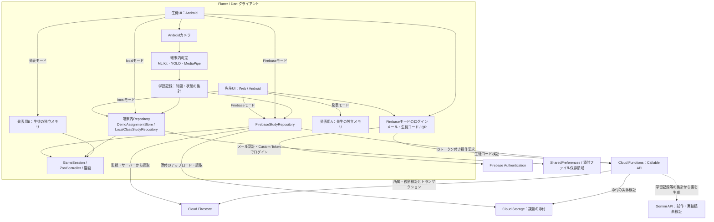
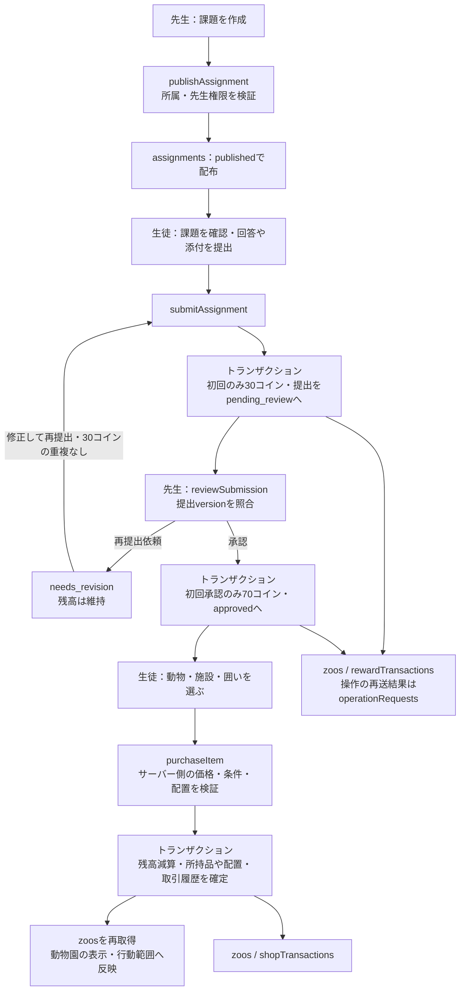

# ZooっとStudy(ずーっとスタディ)略:ずースタ

[](https://www.youtube.com/watch?v=Ys33HINil24)

## 製品概要
### 課題への取り組みを、自分だけの動物園の成長に
ZooっとStudy（ずースタ）は、学習塾などの教育現場を対象に、先生の課題管理と生徒の学習意欲向上を両立する、動物園育成型の学習支援アプリです。

先生は課題の配布、提出状況の確認、承認・再提出依頼を行えます。生徒は先生から発行されたコードやQRコードでログインし、課題への取り組みに応じてコインを獲得します。

獲得したコインで動物や施設を購入し、自分だけの動物園を育てることで、日々の学習に楽しさと達成感を生み出します。

### 背景(製品開発のきっかけ、課題等）
学習を継続するためには、日々の取り組みに対するモチベーションが重要です。しかし、勉強の成果はすぐには実感しにくく、課題への取り組みや自主学習を継続することが難しい場合があります。

一方、学習塾などの教育現場では、先生が課題の配布や提出状況の確認、生徒へのフィードバックを行う必要があります。生徒の学習意欲を引き出すことと、課題を管理することの両方が求められています。

そこで私たちは、先生による課題管理と、生徒が楽しめる動物園育成ゲームを組み合わせたZooっとStudyを開発しました。

課題を提出すると報酬を獲得でき、先生に承認されることでさらに報酬が得られる二段階報酬方式を採用しています。これにより、課題を提出する行動だけでなく、先生からの確認やフィードバックにも意味を持たせています。

学習の積み重ねが動物園の成長として目に見えることで、生徒が自ら学習に取り組むきっかけを作り、先生もその取り組みを支援できる仕組みを目指しています。

なお、学習習慣や課題提出率の改善効果については、今後の実証・検証課題です。

### 製品説明（具体的な製品の説明）
ZooっとStudyは、先生向けの課題管理と、生徒向けの学習記録・2Dドット絵の動物園を組み合わせたアプリです。

#### 1. 先生による課題管理と生徒のログイン

先生はクラスを作成し、生徒を登録して、課題の配布や提出状況の確認を行えます。

登録された生徒には専用のログインコードとQRコードを発行でき、生徒はメールアドレスを用意せずにログインできます。従来のメールアドレスによるアカウント方式にも対応しています。

生徒は課題にテキストで回答するほか、画像やPDFを添付して提出できます。先生は提出内容を確認し、承認または再提出依頼を行います。

#### 2. 課題への取り組みに応じた二段階報酬

生徒は課題の初回提出で30コイン、先生による承認で追加70コインを獲得できます。

再提出時には初回提出報酬を重複して付与せず、同じ操作の再送による二重報酬も防止します。

獲得したコインは動物園の育成に利用でき、課題への取り組みがゲーム内の成長につながります。

#### 3. カメラを利用した自主学習記録

Androidの勉強モードでは、カメラで顔または教材・手元を確認し、判定方式を自動選択します。

判定対象となった時間を同じ日の利用分で合算し、2分につき1コイン、1日最大30コインを終了・保存時に確定します。日付は日本時間の0時で切り替わります。

姿勢や映り方は学習状況を把握するための参考情報であり、理解度や集中度を測定・証明するものではありません。解析用の一時写真は端末内で処理後に削除し、学習記録として画像・音声を保存・送信しません。生徒が課題に添付して提出する画像・PDFは別の保存対象です。

#### 4. 自分だけの動物園を育成

獲得したコインを使って、動物や池、研究所、ベンチ、植木、噴水、フラワーアーチなどを購入できます。

柵は囲い1区画として幅・高さを指定し、面積1マスにつき5コインで購入・拡張できます。

購入した動物は任意の囲いに配置でき、囲いの範囲内で移動と待機を繰り返します。施設と囲いはマップ上でドラッグして配置でき、配置を確定するまで保存しません。

#### 5. 動物の収集と研究所による進化

動物図鑑には所持・未所持を問わず全動物が番号付きで表示され、未所持の動物にはロックアイコンが表示されます。

通常ショップには19種類、研究所には8種類の動物を登録しています。

研究所では狐の派生や氷帝ペンギンなどの特殊な動物を解放できます。進化には研究所の購入・配置と進化元となる動物の所持が必要です。

進化後も元の動物は消費されないため、動物を集めながら新しい種類を増やしていけます。

[動物一覧・暫定価格と進化条件](docs/animal_roster.md)

研究所以外の建築物固有の効果や複雑な進化演出は今後の実装対象です。

#### 6. 学習目標と報酬演出

図鑑から目標となる動物を選択すると、ホーム画面に購入までに必要な残りコイン数を表示します。

新しい報酬が確定すると、短時間の通知や動物のリアクションによって獲得を知らせます。同じ取引による演出の重複は防止します。

目標や演出履歴は生徒ごとの設定として保存されます。

#### 7. アカウントとデータ保存

Firebase AuthenticationとCloud Firestoreを利用し、生徒ごとにコイン残高、所持動物、施設、囲い、配置情報などを管理します。

先生が登録した生徒は専用コードやQRコードでログインでき、Firebase接続時には同じアカウントの保存データを復元できます。

Firebaseエミュレーターによる登録・購入・配置・再ログインなどの検証を実施していますが、本番プロジェクトへのデプロイや実機での総合検証は別途必要です。

[アカウント設定と起動手順](docs/accounts.md)

#### 8. 先生向け学習アドバイス（試作）

先生が生徒の学習記録を確認し、学習状況に応じたアドバイス案を作成・編集して、生徒に送信する機能を試作しています。

Firebase接続時にはGemini APIを利用する構成を用意していますが、外部AIの利用にはAPIキー設定とバックエンドのデプロイが必要です。現段階では実環境でのAI生成機能の検証は完了していません。

発表時は通信・認証不要の[ガイド付きデモ](docs/presentation_tutorial.md)を2台で使い、Aで先生、Bで生徒として操作します。Bは既存の課題メニューから提出し、Aの承認・送信演技後にメニューを開き直して結果を表示します。Bに配布・承認ボタンは置きません。初期資金はデモ専用の3,000コインです。

### 特長
#### 1. 課題提出と承認が動物園の成長につながる
先生から出された課題を提出するとコインを獲得でき、先生による承認でさらにコインが得られます。
課題への取り組みをゲーム内の報酬と結びつけることで、生徒が課題に取り組むきっかけを作ります。

#### 2. 先生と生徒の双方が利用できる
先生は課題の配布、提出状況の確認、承認・再提出依頼を行えます。
生徒は専用コードやQRコードからログインでき、課題提出や自主学習、動物園の育成に取り組めます。
先生による学習支援と、生徒の楽しさを一つのアプリにまとめていることが特長です。

#### 3. 自分だけの動物園を自由に発展できる
動物や施設を購入し、囲いの作成・拡張、施設の配置、動物の割り当てを行えます。
動物は囲いの中を自由に動き回り、学習によって育てた動物園を眺めて楽しめます。
UIと動物園にはドット絵素材を使用し、拡大時にもピクセルがぼやけない描画を採用しています。日本語フォントにはDotGothic16を使用しています。

#### 4. 動物の収集・進化が継続的な目標になる
図鑑には未所持の動物も表示され、次に集めたい動物を目標として設定できます。
研究所では特定の動物を条件として新しい動物を解放でき、元の動物を残しながら収集を進められます。
動物の種類や進化先を増やせる構成にすることで、長期的に遊べるゲームへの拡張を想定しています。

### 解決出来ること
#### 学習を継続するためのモチベーション不足
課題提出や自主学習を動物園の育成に結びつけることで、生徒が学習に取り組むための新しい目標を提供します。

#### 日々の学習成果を実感しにくいこと
学習時間・獲得コインの記録と、動物の収集・配置を通じて、取り組みの積み重ねを振り返れます。

#### 学習習慣の定着が難しいこと
獲得コイン、学習記録、動物の収集・配置を通じて、日々の取り組みを目に見える形で残します。

### 今後の展望
* Firebaseの本番設定・デプロイと、Android実機・別端末での保存復元の確認。
* 動物・施設の追加、進化演出、研究所以外の建築物固有の機能の実装。
* 学習画面の専用ドット絵アイコンの追加と、Android実機での操作性検証。
* 先生・生徒の利用を通じた学習継続・課題管理の使いやすさの検証。

### 注力したこと（こだわり等）
* 先生の課題管理と生徒の動物園育成を組み合わせ、学習行動がゲーム内の報酬につながる仕組みを設計。
* 課題提出時と先生による承認時の二段階報酬を採用し、報酬の重複付与を防止。
* ゲーム描画・配置ルール・データ取得を分離し、動物や商品をJSONで追加できる拡張性の高い構成。
* スプライトの切り出し、タイルの回転、枠の分割描画によってドット絵素材を再利用。
* 動物の移動範囲と囲いの配置を連動させ、複数の動物が動き回る動物園を実装。
* 購入・報酬の重複処理への対策、保存失敗時の再試行、配置確定前のプレビュー。
* カメラによる学習判定で映像や音声を学習記録として保存・送信しない設計。

## 開発技術

### システムアーキテクチャと実装状況

先生向けWeb画面と生徒向けAndroid画面は、別々のシステムではなく同じFlutter / Dartコードベースの役割別UIです。先生画面はAndroidでも利用します。起動時にデータ取得先を切り替え、Firebase接続・端末内保存・発表専用デモを分離しています。

| 区分 | 確認できる実装・検証範囲 |
| --- | --- |
| 実装済み | 課題・添付提出、二段階報酬、購入・配置・研究、役割別UI。ローカルのロジック・Widgetテストを用意 |
| Firebase連携 | Auth・Firestore・Storage・Callable Functionsの接続コードを実装。認証付き提出・購入・配置・権限制御にはエミュレーターでの検証記録あり。本番デプロイ・実機の端末間総合検証とは区別 |
| Android学習判定 | ML Kit・YOLO・MediaPipeを使う端末内処理を実装。判定ロジックのテストと、カメラ・モデルを使う実機での精度検証は別 |
| 試作 | Gemini APIによるアドバイス案生成。キー・モデル設定・Functions配備が必要で、実API接続と生成品質は未検証 |
| デモ専用 | `ZOOSTUDY_PRESENTATION=true` はA・B各端末の独立したメモリ内データ。役割選択は認証の代替であり、課題・承認結果の表示も実通信ではない |

次の図は実装上の接続経路です。Firebaseへの線はFirebaseモードでのみ使い、Geminiへの破線は接続コードがある試作経路を表します。



Firebaseモードでは、クライアントが残高・提出状態を直接確定せず、Functionsの結果をFirestoreから読み直します。例外は本人の目標・演出履歴を保存する `CloudGamePreferences` で、`gamePreferences` への制限付き書き込みを許可しています。端末内モードの名前空間による分離は、Firebaseの認証・Security Rulesによる権限制御の代替ではありません。

### 課題管理と二段階報酬のデータフロー

以下はFirebaseモードの処理です。発表用デモのA・B間にこの通信が発生するわけではありません。



- **報酬の一意性**：報酬履歴のIDを `${assignmentId}_${studentId}_submit` と `${assignmentId}_${studentId}_approve` に固定し、履歴の作成・残高加算・提出状態の更新を同一トランザクションで行います。再提出や別の要求IDによる再操作でも、同じ報酬を増やしません。
- **操作の再送**：課題操作は `operationRequests/{uid_requestId}` に要求内容の `fingerprint` と結果を保存。同じ要求は結果を再利用し、同じIDで内容が異なる要求は拒否します。承認は `expectedVersion` も照合し、読み込み後に変更された提出を誤承認しないようにします。
- **購入・配置の整合性**：`shopTransactions/{uid_requestId}` と動物園更新を一括確定。価格・進化条件・囲いの面積差額はサーバーが計算し、クライアントから送られた残高や価格を採用しません。
- **実同期とデモの違い**：FirebaseはFirestoreの変更監視とサーバー再取得で他端末の更新を反映します。端末内モードは同じ端末のクラス・生徒データを読み直す方式です。発表用Bは配布済み課題を持ち、提出後の課題メニュー再訪で準備済みの承認結果・アドバイスを表示するだけで、Aの操作完了を検出しません。

### データベース・保存設計

Firestoreの主要コレクションと、実装されているフィールドの抜粋です。`organizationId`・`classId` による所属検証と、`classMemberships.role` による役割判定をFunctionsとSecurity Rulesで行います。

| 保存先 | 主なフィールド・責務 |
| --- | --- |
| `users/{uid}` | `organizationId`, `classId`, `displayName`。利用者の所属・選択中クラス |
| `classes/{classId}` / `classMemberships/{classId_uid}` | クラスの `organizationId`, `name` と、所属の `classId`, `userId`, `displayName`, `role`。先生は複数クラスを管理し、選択中クラスを切り替える |
| `assignments/{assignmentId}` | `teacherId`, `title`, `description`, `subject`, `dueAt`, `status`, `submissionReward`, `approvalReward`。所属クラスへ配布 |
| `submissions/{assignmentId_studentId}` | `assignmentId`, `studentId`, `answerText`, `attachments`, `status`, `version`, `revisionCount`, `feedback`, `reviewedBy`。状態は `pending_review` / `needs_revision` / `approved`。未提出は提出ドキュメントがない状態 |
| `zoos/{uid}` | `studentId`, `coins`, `revision`, `ownedAnimalIds`, `ownedFacilityIds`, `layout`。`layout` は `enclosures`, `animalEnclosures`, `facilities` を持ち、囲いの座標・寸法、動物と囲いの対応、施設の座標を保存 |
| `rewardTransactions/{transactionId}` | `assignmentId`, `studentId`, `kind`, `amount`, `confirmedAt`。課題報酬の履歴 |
| `operationRequests/{uid_requestId}` / `shopTransactions/{uid_requestId}` | 前者は `fingerprint`, `result`, `createdAt`、後者は `studentId`, `itemId`, `fingerprint`, `receipt`。再送結果と購入・配置取引を管理 |
| `studySessions/{uid_recordId}` / `studyDailyRewards/{uid_day}` | 記録の `record`, `fingerprint`, `rewardAmount`, `source` と、日別の `day`, `eligibleMs`, `coinsGranted`。同じ記録の重複保存や日次上限超過を防止 |
| `studyAdviceDrafts/{adviceId}` / `studyAdvice/{adviceId}` | 先生用下書きの `summary`, `teacherNote`, `message`, `aggregate`, `status`。送信時は承認した `message` を生徒向けへコピーし、`summary`・`teacherNote` は空にする |
| `gamePreferences/{uid}` | `goalId`, `seen`。本人の目標と表示済み演出の履歴。残高や所持品とは分離 |

メール・パスワードの認証情報はFirebase Authenticationが担当します。生徒コードには `studentLoginCodes`・`studentCodeAccounts`、クラス接頭辞には `classLoginPrefixes`、試行制限には `studentCodeAttempts` を使用し、コードのハッシュを検証してCustom Tokenを発行します。招待による生徒参加には `classInvitations` を使用します。先生権限の自己登録は提供せず、管理者による事前の所属設定が必要です。

| モード・対象 | 保存先と範囲 |
| --- | --- |
| Firebaseの正本 | 上記Firestore。`zoos` はUID別の個人データで、クライアントからの残高・所属・提出状態の直接更新は拒否 |
| 課題の添付 | Cloud Storageの `submissionFiles/{organizationId}/{classId}/{assignmentId}/{studentId}/{fileName}`。JPEG・PNG・PDF、各10MiB・最大3件。Functionsで実体・所有者・形式・ハッシュを確認。本人と担当クラスの先生のみ読取可能 |
| 通常の端末内モード | SharedPreferencesに `study-state` や下書きを保存。`StudentAccountStorage`・`ClassAccountStorage` で生徒・クラスごとのキーを分離。添付本体はAndroidのアプリ用ファイル領域、WebはIndexedDB |
| Firebase利用時の端末側 | 未送信の下書きを利用者・クラス別に保存。サーバーで確定した残高の代わりにはしない |
| 発表用デモ | A・B別々のメモリのみ。初期3,000コイン・無料の囲い・最後の完成景はデモ設定で、実アカウントへ保存しない |

### ゲーム内部アーキテクチャ

ゲームはFlutter標準のWidget・`CustomPainter`・`Ticker`で構成し、Flameは導入していません。課題管理から受け取る情報を `GameSnapshot` にまとめ、学習画面やFirebase SDKを動物の移動ロジックに持ち込まない構成です。

| 層 | 役割と設計意図 |
| --- | --- |
| 定義データ | `assets/zoo/world.json` にタイルマップ・動物のID、速度、画像パス、移動エリア・施設を定義。`assets/zoo/shop_catalog.json` に価格、入手方式、進化元、必要施設などを定義し、種別ごとの条件をデータで追加できる |
| 取得・取引 | `GameRepository`・`ShopRepository` のインターフェースでFirebase／モックを切り替える。`GameSession` は確定スナップショットを購読し、古い `revision` や別利用者のデータを採用しない |
| ゲームロジック | `ZooController` が所持情報と配置を反映し、`AnimalWalker` が待機とランダム移動を繰り返す。`animalEnclosures` で割り当てた囲いから行動範囲を算出し、拡張・配置変更時も範囲内に収める |
| 配置ルール | `layout_rules.dart`・`facility_placement.dart` がマップ外、通路、水辺、施設・囲いの重なりを判定。編集中はローカルの仮配置で、確定成功後に反映。Firebaseモードではサーバーでも再検証する |
| 描画 | `ZooMap` がタイル背景・施設・動物を合成。背景側は `sceneryRevision` と `RepaintBoundary`、動物側は更新通知を使い分ける。移動時間の刻みを最大0.1秒に制限し、復帰時の大きな位置飛びを抑える |
| 収集・研究 | 所持IDを図鑑のロック・表示へ反映。研究商品は進化元の所持・研究所の購入と配置などを検証し、進化元を消費せず新しい動物を追加する |

サーバー側の正規価格・マップは `functions/catalog.json`・`functions/game_world.json` で管理します。クライアント定義と別ファイルのため、追加時は両方を更新する必要があり、バックエンドテストに内容の一致確認があります。JSONを追加するだけですべてのアカウント経路へ自動配信される仕組みではありません。

### 技術的な工夫と現在の限界

- **ゲームと学習の疎結合**：課題報酬や自主学習報酬を確定データとして取り込み、購入・配置・移動・描画を分離。取得先を差し替えたデモでも同じゲームロジックを使います。
- **権限と整合性の二重検証**：Firebaseでは読取範囲をSecurity Rulesで制限し、書込操作はCallable FunctionsでもUID・塾・クラス・役割を検証。報酬・購入・配置はFirestoreトランザクションで確定し、学習報酬と購入が同時でも残高の上書きを防ぐ設計です。
- **学習判定を端末内に留める**：ML Kitの顔検出、Kotlinの `StudyDetectorBridge` 経由の日本語OCR・MediaPipeの手検出、YOLOの物体検出を組み合わせます。映り方に応じて方式を選び、記録は時間・状態別集計などに限定。音声は無効化し、一時写真は解析の `finally` で削除します。モデルの初回準備には通信が必要な場合があります。
- **観測と評価を区別**：自主学習報酬は日本時間の日別対象時間を合算し、2分1コイン・日最大30コイン。サーバーは記録の形式・重複・上限を確認しますが、端末の観測記録から理解度や学習実態を証明するものではありません。
- **先生が確認するAI試作**：Functionsで直近7日とその前7日の利用時間・科目別時間・課題提出状況を集計してGeminiへ渡す構成です。氏名・画像・OCR本文・提出回答は送らず、先生が編集・承認した文章だけを生徒へ公開します。実API接続・生成品質の検証は残っています。
- **ドット絵を保つ再利用**：スプライトシートを矩形で切り出し、`FilterQuality.none`・アンチエイリアス無効で描画。端末の画素倍率を考慮した拡大、タイルの90度回転、枠の分割描画で既存素材を再利用し、DotGothic16も同梱して外部フォント取得を不要にしています。
- **拡張時の制約を明示**：現行Firestoreルールでクラウド保存できる `goalId` は `rabbit`・`fox`・`deer`・`evolved_fox`（および未設定）のみです。追加動物を含む全図鑑の目標保存への対応、研究所以外の施設固有効果、より複雑な進化演出は今後の対象です。

根拠となる実装：[Firebase接続Repository](lib/features/study/data/firebase_study_repository.dart)、[課題・報酬処理](functions/service.js)、[購入・配置処理](functions/game_purchase.js)、[アドバイス試作](functions/study_advice.js)、[Firestoreルール](firestore.rules)、[添付のルール](storage.rules)、[バックエンド検証コード](functions/test/backend.test.js)。検証記録は[アカウント設定](docs/accounts.md)・[保存機能の手順](lib/features/study/STORAGE.md)を参照してください。これらのローカル・エミュレーターでの確認は、本番配備やAndroid実機・Webでの総合検証の完了を意味しません。

### 活用した技術
#### API・データ
* Firebase Authentication、Cloud Firestore、Cloud Functions、Cloud Storage。接続にはFirebase設定とバックエンドの準備が必要です。
* 動物・マップ定義：`assets/zoo/world.json`、商品定義：`assets/zoo/shop_catalog.json`。バックエンドの正規カタログは別管理です。
* 保存モード・Firebase設定・エミュレーターの手順は [STORAGE.md](lib/features/study/STORAGE.md) を参照してください。

#### フレームワーク・ライブラリ・モジュール
* Flutter / Dart：アプリUI、動物園描画、ゲームロジック。
* camera、google_mlkit_face_detection、ultralytics_yolo：Androidの学習判定。
* shared_preferences、path_provider、idb_shim：端末側データ保存。image_picker、file_selector、pdfrx：添付選択・表示。
* DotGothic16：オフライン利用できる同梱フォント。[ライセンス](assets/fonts/OFL-DotGothic16.txt)。

依存関係の取得と確認は、プロジェクト直下で実行します。

```sh
flutter pub get
flutter analyze
flutter test
```

ローカルデモはデバッグ実行専用です。Android StudioでAndroid端末を選択して起動するか、`flutter devices` で端末IDを確認して次を実行します。

```sh
flutter run -d <Android端末ID> --dart-define=ZOOSTUDY_STORAGE=local
```

#### デバイス
* Android：生徒向けアプリとカメラによる勉強モードの主対象。
* Web：先生向け課題管理など。カメラによる勉強判定はAndroid版のみ対応。
* iOS：Flutterのプロジェクト構成は保持していますが、実機動作は未検証です。Windowsデスクトップ用プロジェクトは含みません。

### 独自技術
#### ハッカソンで開発した独自機能・技術
* 課題提出と先生の承認に応じた二段階報酬、および学習対象時間の日次集計によるコイン付与。
* 自由配置できる囲いと動物の移動範囲の連動、施設配置の衝突検証、購入・配置の取引モデル：[ゲーム連携契約](docs/game_integration_contract.md)、[囲い](docs/enclosure_system.md)、[施設配置](docs/facility_placement.md)。
* 番号・ロック表示を備えたページ式の図鑑：[animal_encyclopedia.dart](lib/features/animals/presentation/animal_encyclopedia.dart)。
* スプライトを使った共通UI：[建築物と枠](docs/building_sprites.md)、[学習UIと不足素材](docs/study_pixel_ui.md)。

学習機能班との接続仕様と検証範囲：[体験改善フェーズ](docs/game_experience_phases.md)、[Firebase担当への接続仕様](docs/game_backend_handoff.md)。

画面の入口とショップの整理：[共通ナビの説明](docs/navigation_and_shop.md)。

アカウントの新規登録・保存：[アカウント設定](docs/accounts.md)。通常の起動は端末内デモで、アカウント機能には `ZOOSTUDY_STORAGE=emulator` またはFirebase設定を指定します。
